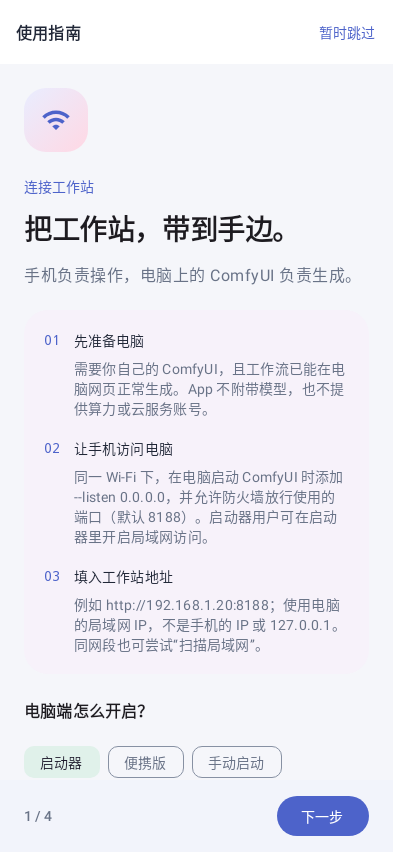
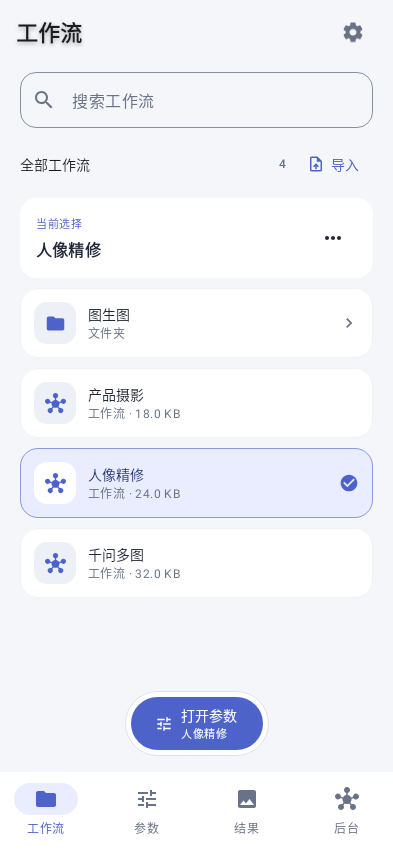
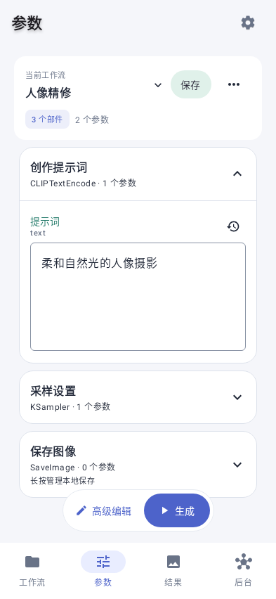

**A native Android companion for your own ComfyUI.**

[Download APK](https://github.com/7116-byte/ComfyUIMobile/releases/latest) · [简体中文](README.md) · [Report an issue](https://github.com/7116-byte/ComfyUIMobile/issues/new/choose)

Your models and workflows stay on your workstation. Use your phone or tablet to browse workflows, edit parameters, submit jobs, and save original results. The app uses Kotlin and Jetpack Compose, with phone navigation, tablet split layouts, and system light / dark themes. The app interface currently prioritizes Simplified Chinese.

## Preview

These are native Compose renders with synthetic test data, not private user workflows or artwork.

## Get started

1. Download the signed release APK from [GitHub Releases](https://github.com/7116-byte/ComfyUIMobile/releases/latest). Android 8.0+ is required. Install over an existing official version to retain data.
2. Run your own ComfyUI with LAN access enabled. Append `--listen 0.0.0.0` to your existing launch command, preserving other arguments. Allow the actual port through your firewall on a trusted network.
3. On your phone, first open `http://YOUR_COMPUTER_IP:PORT` in a browser. If reachable, use the same address in the app; for example, `http://192.168.1.20:8188`.
4. Select a workflow, tap **打开参数** (open parameters), edit it, and tap **生成** (generate).

The first-use guide can be skipped and reopened from the connection screen or settings. See the [connection guide](docs/connection-guide.md) for launcher, Windows portable, and Python setup instructions in Chinese.

## What it does

- Workflow folders, search, import / export, and explicit server saving.
- Native prompt, number, model, image, ordered multi-image, and video controls.
- Original server frontend for advanced custom widgets, sharing the current working copy.
- Local / server results, job albums, zoom, original downloads, and generation metadata.
- Output allowlists for automatic local saving, with explicit ownership / takeover of jobs.
- Queue, workstation information, task monitoring, and signed release updates.

## Connection compatibility

Starting with v0.1.74, the app accepts **HTTP / HTTPS root addresses**, with secure WebSocket for HTTPS instances. HTTPS uses port 443 when omitted; nonstandard ports are preserved. Existing HTTP addresses retain the default ComfyUI port 8188. It needs a complete ComfyUI instance: the real frontend, node definitions, userdata workflows, upload, task / result APIs, and WebSocket.

Path-prefix proxies, platform logins, cookies, API keys, token-bearing URLs, app sharing pages, serverless endpoints, and Comfy Cloud / deployed workflow APIs are **not currently supported**. Cloud GPU instances require a directly reachable full HTTP / HTTPS service; no cloud vendor acceptance is claimed. Invalid TLS certificates are rejected. Do not replace an HTTPS URL with HTTP or expose an unauthenticated instance publicly. Settings include a direct link to this GitHub project.

## Data and limits

Parameter changes affect a working copy; only explicit **保存 / 另存** saves to the server. Optional local drafts apply to saved server workflows; temporary imports require saving for long-term retention. Server thumbnails are not automatically local copies: enable automatic saving and configure output allowlists, or save manually. Export important work before clearing data or uninstalling.

Custom nodes may require advanced editing. Missing models / nodes must be resolved on the workstation. Audio has no dedicated player yet. Real-time node progress for other clients' jobs is limited by the server protocol. The app does not provide GPU compute or models.

## Contribute

See [CONTRIBUTING](CONTRIBUTING.md) for Debug builds and PR guidance, [documentation](docs/README.md) for technical notes, and [release notes](RELEASE_NOTES.md) for changes. Please remove private addresses, credentials, prompts, and artwork from issue reports.

Built on [ComfyUI](https://github.com/Comfy-Org/ComfyUI). This is an independent client, not an official Comfy product. Licensed under [MIT](LICENSE).
