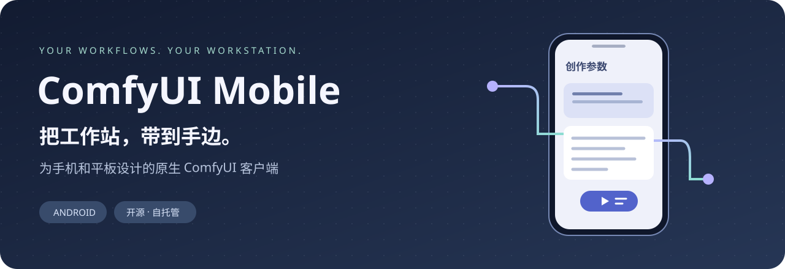
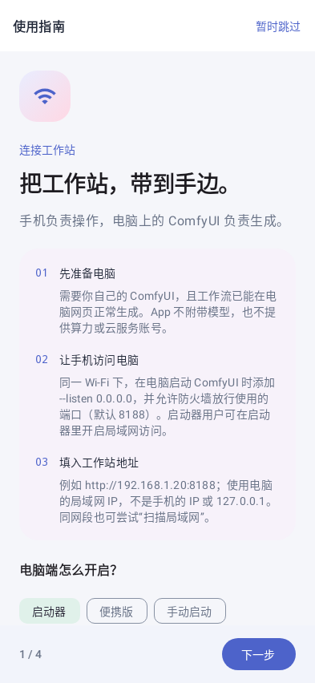
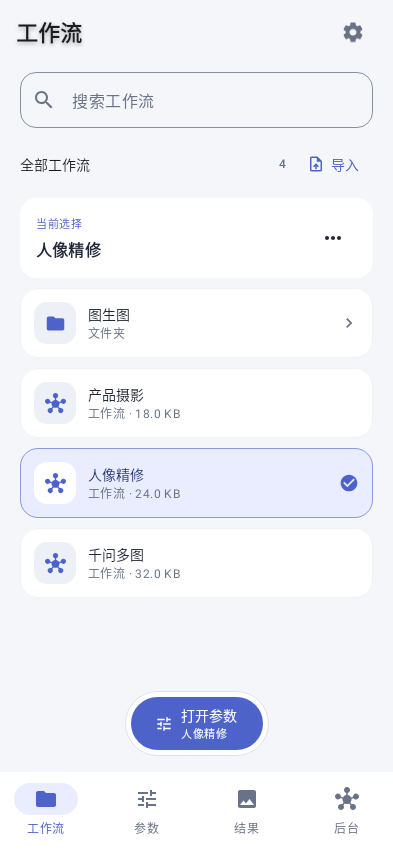
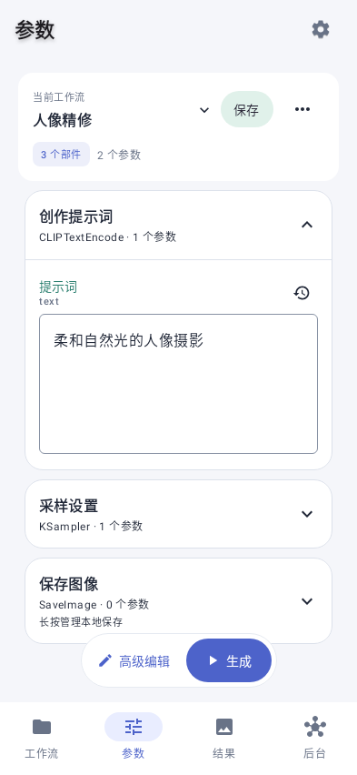
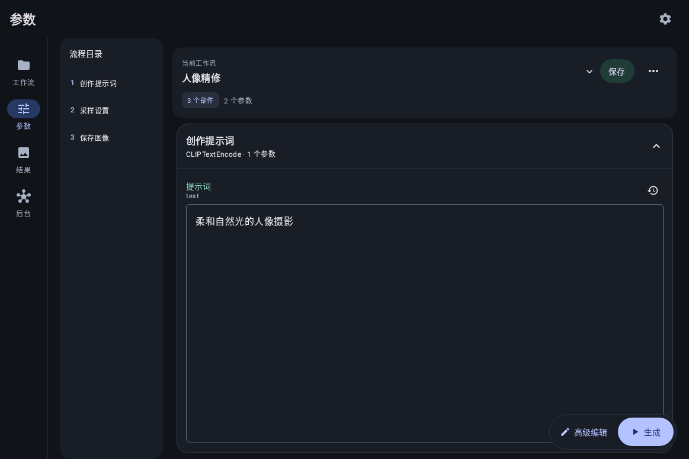

**连接自己的 ComfyUI，用手机和平板继续创作。**

A native Android companion for your own ComfyUI — workflows, parameters, and original results.

   

[**下载 APK**](https://github.com/7116-byte/ComfyUIMobile/releases/latest) · [连接教程](docs/connection-guide.md) · [使用指南](docs/user-guide.md) · [English](README.en.md)

## 在手机上，专注创作

工作流和模型留在你的工作站，手机负责选择工作流、调整参数、提交任务和查看作品。日常操作使用原生触控界面；需要遮罩、画板等复杂控件时，再进入服务器的高级编辑。

| 从哪里开始 | 可以做什么 |
| --- | --- |
| **工作流** | 搜索与文件夹浏览，导入文件或带工作流的图片，点选后打开参数 |
| **参数** | 提示词、种子、模型、单图与有序多图；悬浮生成操作，错误定位到部件 |
| **结果** | 本地 / 云端分开查看，任务相册、图片缩放、原图保存、生成参数查看 |
| **后台** | 队列、任务状态、工作站与 GPU 信息，跟踪本 App 提交或明确接管的任务 |

手机使用底部导航，平板使用侧栏和分栏；深浅主题跟随系统。首次打开有可跳过的引导，之后可从连接页或设置重新查看。

## 界面预览

 
连接指南 · 工作流 · 参数
  

截图为真实 Compose 界面的测试数据渲染，不含用户工作流或作品。更多预览与来源见 [截图说明](docs/screenshots/README.md)。

## 下载安装

1. 打开 [最新正式版 Release](https://github.com/7116-byte/ComfyUIMobile/releases/latest)，下载 APK。
2. 在 Android 8.0 或以上设备安装，按系统提示允许此次安装。
3. 已装正式版可直接覆盖更新；也可从 App 的 **设置 → 软件更新** 检查、下载和安装。

Release 同时提供 APK 的 SHA-256 校验文件。正式版延续原包名与签名；独立的预览版与正式版数据互不相通。旧版检查不到更新时，请从 Release 下载覆盖，详见 [更新检查说明](docs/update-checks.md)。重要作品请另行备份，避免卸载重装。

## 三步开始

**① 准备工作站**

先让 ComfyUI 工作流在电脑网页正常运行，再开启局域网监听。已有启动命令追加 `--listen 0.0.0.0`；启动器用户在设置里开启局域网访问或添加监听参数，然后重启 ComfyUI。

**② 连接手机**

手机与电脑接入同一局域网，填写 `http://电脑的局域网IP:实际端口`，例如 `http://192.168.1.20:8188`。先用手机浏览器打开这个地址确认可达，再回 App 连接。同网段也可尝试扫描。

**③ 打开工作流**

点选工作流 → **打开参数** → 调整参数 → **生成**。完成后在“结果”查看；要自动保存到手机，需设置输出白名单并开启自动保存。

**第一次配置？** [完整连接教程](docs/connection-guide.md) 包含启动器、便携版 `.bat`、手动 Python 启动、IP 查找、防火墙和排错步骤。

## 我能连接什么？

| 连接方式 | 当前支持情况 |
| --- | --- |
| 自有电脑，同一局域网 | 支持，需开放监听及相应端口 |
| 已互通的 VPN / 虚拟局域网 | 支持使用可达的 HTTP 根地址；App 不负责建立 VPN |
| 云 GPU 上的完整 ComfyUI 实例 | 条件支持：须提供可直达的 HTTP 根地址、原生接口、前端和 WebSocket，需实测 |
| HTTPS 分享页、平台登录 / Cookie / API Key、带路径或令牌的链接 | 目前不支持 |
| 纯 API、Serverless、部署后的单工作流接口、Comfy Cloud API | 目前不支持直接接入 |

“浏览器能打开一个网页”不等于完整兼容。App 需要服务器自己的前端、节点定义、工作流读写、上传和任务接口；它不提供算力、模型或平台账号。ComfyUI 通常没有默认访问认证，请在可信网络或 VPN 内使用，不要直接公开无认证端口。更多判断方法见 [云平台兼容说明](docs/connection-guide.md#云平台给的纯链接能用吗)。

## 保存规则，先说清楚

- **服务器工作流**：点“保存 / 另存”才写回服务器，日常修改先留在手机工作副本。
- **本地草稿**：在设置中开启后，可恢复已保存服务器工作流的未保存修改；临时导入需手动保存才能长期保留。
- **本地作品**：云端可见不代表已下载。自动保存需命中输出白名单，只处理本 App 提交或明确接管的任务；也可手动保存原图。

复杂自定义节点可能需要高级编辑，缺少节点或模型需在电脑端处理。音频等输出暂以任务元数据展示；其他客户端任务的实时节点进度受 ComfyUI 服务端能力限制。详见 [使用指南](docs/user-guide.md)。

## 参与项目

遇到问题请 [提交 Issue](https://github.com/7116-byte/ComfyUIMobile/issues/new/choose)，注明 App / ComfyUI 版本、连接类型与复现步骤；请遮盖地址、令牌、提示词和个人作品。欢迎改进兼容性、无障碍、小屏体验及文档，也欢迎分享实际使用反馈。

| 文档 | 内容 |
| --- | --- |
| [使用指南](docs/user-guide.md) / [连接教程](docs/connection-guide.md) | 从第一次连接到保存作品 |
| [贡献指南](CONTRIBUTING.md) | 构建 Debug、反馈问题和提交修改 |
| [更新记录](RELEASE_NOTES.md) | 各版本变化 |
| [开发文档](docs/development.md) / [文档索引](docs/README.md) | 工具链、测试、设计与技术记录 |

如果这个项目帮你把 ComfyUI 用得更顺手，欢迎点一颗 Star，让更多创作者找到它。

## 致谢与许可

基于 [ComfyUI](https://github.com/Comfy-Org/ComfyUI) 的服务端与前端能力，使用 Kotlin、Jetpack Compose、OkHttp、Coil 和 AndroidX Media3 构建。此项目为独立客户端，与 Comfy 组织无隶属关系。

[MIT License](LICENSE) · Copyright © 2026 7116-byte
